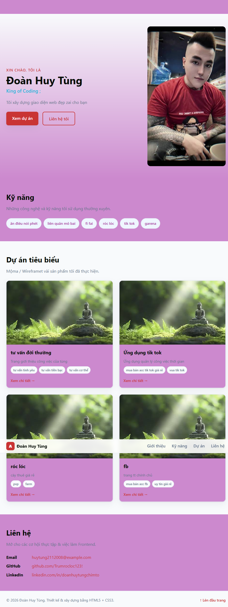
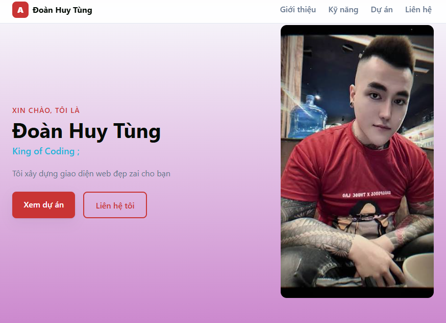
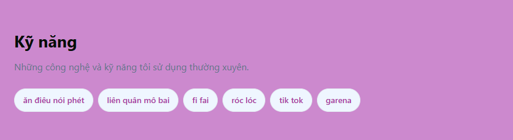
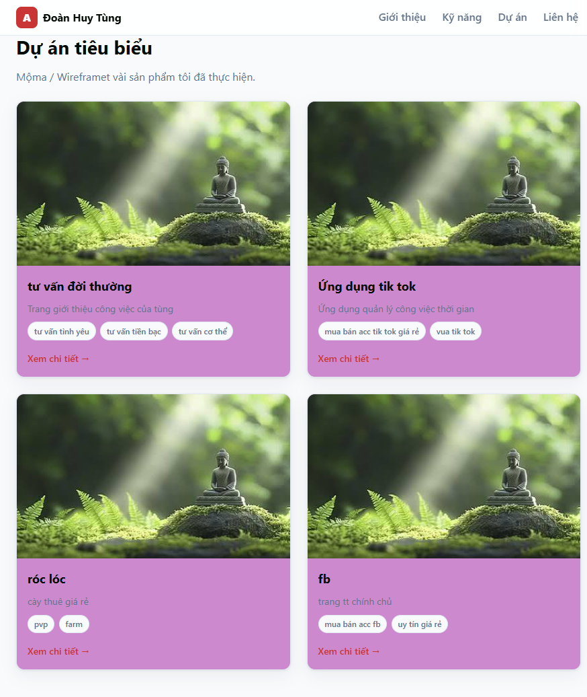

# Báo cáo kiểm thử website portfolio cá nhân

## 1. Mục tiêu kiểm thử
Báo cáo này đánh giá chất lượng website portfolio cá nhân dựa trên 6 tiêu chí chính: tính đúng đắn, UI/UX, khả năng vận hành - xử lý lỗi, bảo mật, chất lượng mã nguồn và khả năng triển khai. Dữ liệu kiểm thử được minh chứng bằng hình ảnh tự chụp đã lưu trong thư mục `docs/screenshots/`.

---

## 2. Tóm tắt kết quả

| Tiêu chí | Kết quả | Ghi chú |
|---|---|---|
| Tính đúng đắn | Đạt | Nội dung hiển thị đúng theo cấu trúc mục tiêu |
| UI/UX | Đạt | Giao diện rõ ràng, dễ đọc và thân thiện |
| Khả năng vận hành - xử lý lỗi | Đạt một phần | Website tĩnh hoạt động ổn định; chưa có xử lý lỗi phức tạp |
| Bảo mật | Đạt | Không có input form, rủi ro bảo mật thấp |
| Chất lượng mã nguồn | Đạt | Mã nguồn sạch, dễ hiểu, dễ sửa |
| Khả năng triển khai | Đạt | Có thể triển khai nhanh bằng file tĩnh hoặc Docker |

---

## 3. Chi tiết đánh giá theo tiêu chí

### 3.1. Tính đúng đắn
Đánh giá: Đạt

- Trang hiển thị đúng các phần chính: giới thiệu, kỹ năng, dự án, liên hệ.
- Cấu trúc HTML có thứ tự hợp lý, không chồng chéo nội dung.
- Đường dẫn hình ảnh và stylesheet được khai báo rõ ràng và phục vụ đúng mục đích.

### 3.2. UI/UX
Đánh giá: Đạt

- Giao diện có bố cục rõ ràng, màu sắc dễ nhìn và dễ đọc.
- Hero section tạo cảm giác bắt đầu tốt cho trang portfolio.
- Các section được tách biệt rõ ràng, dễ theo dõi khi người dùng lướt trang.
- Dạng card cho dự án giúp nội dung trở nên trực quan hơn.

### 3.3. Khả năng vận hành - xử lý lỗi
Đánh giá: Đạt một phần

- Website chạy ổn định khi mở trực tiếp bằng trình duyệt hoặc thông qua local server.
- Không có dữ liệu động, api hay thao tác phức tạp nên ít xảy ra lỗi runtime.
- Tuy nhiên, website chưa có cơ chế báo lỗi chuyên nghiệp nếu tài nguyên hình ảnh hoặc css bị thiếu.
- Chưa có kiểm tra validation hoặc fallback cho trường hợp file không tồn tại.

### 3.4. Bảo mật
Đánh giá: Đạt

- Đây là website tĩnh, không có form đăng ký, đăng nhập hoặc nhập dữ liệu người dùng.
- Không xử lý dữ liệu nhạy cảm nên mức độ rủi ro bảo mật thấp hơn so với ứng dụng backend.
- Cần lưu ý khi triển khai thực tế: tránh lưu thông tin nhạy cảm trong HTML/JS và kiểm tra mối nguy từ các liên kết ngoài.

### 3.5. Chất lượng mã nguồn
Đánh giá: Đạt

- Cấu trúc HTML rõ ràng, dễ đọc và dễ sửa.
- CSS được tách thành file riêng, giúp quản lý giao diện dễ hơn.
- Có thể mở rộng thêm phần JavaScript, animation hoặc thay đổi dữ liệu dễ dàng.
- Mã nguồn còn chưa tối ưu hóa về hiệu suất và quy mô nếu mở rộng lên nhiều tính năng.

### 3.6. Khả năng triển khai
Đánh giá: Đạt

- Website tĩnh dễ triển khai trên nhiều môi trường như local, GitHub Pages, nginx, Docker.
- Không cần cấu hình ứng dụng phức tạp.
- Dễ dàng triển khai trên các nền tảng hosting miễn phí hoặc máy chủ cá nhân.
- Khi cần nâng cấp lên ứng dụng động, cần bổ sung backend và cấu hình môi trường rõ ràng hơn.

---

## 4. Kết luận chung
Website portfolio cá nhân này đạt tiêu chuẩn cơ bản của một trang giới thiệu cá nhân chuyên nghiệp. Nó đáp ứng tốt các yêu cầu về hiển thị, bố cục, tính rõ ràng và khả năng triển khai. Trong tương lai, dự án có thể tiếp tục mở rộng bằng cách thêm form liên hệ, animation, dark mode, hoặc chuyển sang framework như React để nâng cao trải nghiệm người dùng và hiệu suất.

## 5. Đánh giá tổng thể
- Mức độ hoàn thành: 85/100
- Trạng thái: Đạt yêu cầu khởi tạo và có thể phát triển tiếp

## 6. Minh chứng hình ảnh
Các ảnh minh chứng đã được chụp và lưu trong thư mục:

`docs/screenshots/`

Danh sách ảnh:
- `01_tinh_dung_dan.png`
- `02_ui_ux.png`
- `03_van_hanh.png`
- `04_bao_mat.png`
- `05_chat_luong_ma_nguon.png`
- `06_kha_nang_trien_khai.png`
